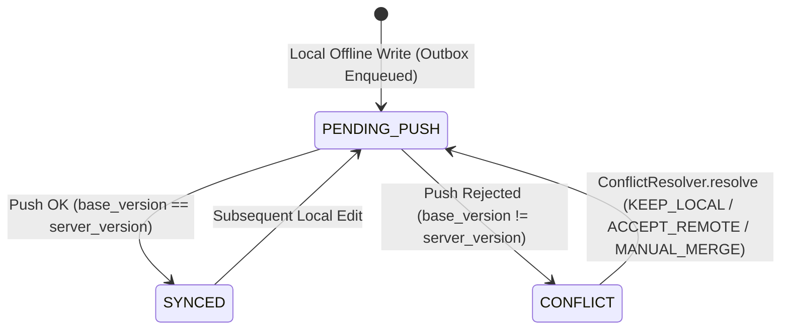

# Specification: Offline-First Sync Engine & Deterministic Conflict Resolution

- **Bounded Context**: `fieldnotes-mobile` — Local-First Inspection Core (`src/domain/`)
- **Status**: Approved (SDD-First)
- **Python Version**: 3.12+ (Zero external or infrastructure dependencies in `src/domain/`)
- **Branch Context**: `feat/offline-first-sync-engine` (derived from `dev`)

---

## 1. Purpose & Architectural Invariants

`fieldnotes-mobile` implements a **Local-First, Offline-First Mobile Inspection Core** designed for industrial field technicians operating in intermittent or zero-connectivity environments. Local reads and writes always succeed immediately against on-device persistence, mutations are durably queued in a **Persistent Mutation Outbox**, causal ordering across distributed devices is established through a **Thread-Safe Lamport Logical Clock**, and concurrent edits are detected and reconciled through **Deterministic Optimistic Concurrency Control & Explicit Conflict Resolution**.

### Core Domain Purity Invariants (`.agents/rules/domain-purity.md`)
1. **Zero External / Infrastructure Dependencies**: `src/domain/` may import **only** from the Python 3.12 standard library (`__future__`, `collections.abc`, `dataclasses`, `datetime`, `enum`, `math`, `threading`, `typing`). No HTTP clients, web frameworks, SQL drivers, ORMs, or UI libraries are permitted.
2. **Immutable & Self-Validating Models**: Every entity and value object is defined with `@dataclass(frozen=True)` and validates all invariants inside `__post_init__`. Invalid construction never silently clamps, truncates, or coerces corrupted values.
3. **Explicit Typed Domain Exceptions**: Every validation error, missing note, optimistic version conflict, invalid conflict resolution, or offline network failure raises a dedicated subclass of `DomainError` carrying a deterministic machine-readable `code`.
4. **Strict Non-Bool Numeric Discipline**: Because `bool` is a subclass of `int` in Python (`isinstance(True, int) is True`), all numeric validations explicitly reject `bool` instances (`not isinstance(v, bool)`), as well as `NaN` and `±inf` for floating-point coordinates.
5. **Dependency Inversion**: All local SQLite/device storage and remote synchronization backend boundaries are expressed exclusively as `@runtime_checkable` `Protocol` ports in `src/domain/repositories.py`.

---

## 2. Typed Domain Exceptions (`src/domain/exceptions.py`)

All domain exceptions inherit from `DomainError(Exception)`. Each subclass defines a class-level `code: str` attribute and populates instance attributes `self.message`, `self.code`, and `self.details: dict[str, Any]`.

| Exception Class | Error Code (`code`) | Constructor Signature | Trigger Condition |
| :--- | :--- | :--- | :--- |
| `DomainError` | `ERR-500-DOMAIN-ERROR` | `(message: str, *, code: str \| None = None, details: dict[str, Any] \| None = None)` | Base class for all domain invariant violations. |
| `InvalidFieldNoteError` | `ERR-400-INVALID-FIELD-NOTE` | `(message: str, *, code: str \| None = None, details: dict[str, Any] \| None = None)` | Invalid `GeoCoordinate`, `FieldNote`, `PendingMutation`, `ConflictRecord`, `SyncAuditRecord`, or `LamportClock` input. |
| `NoteNotFoundError` | `ERR-404-NOTE-NOT-FOUND` | `(note_id: str, message: str \| None = None)` | Operation targets a `note_id` not present in the local or remote store. Stores `self.note_id`. |
| `SyncConflictError` | `ERR-409-SYNC-CONFLICT` | `(note_id: str, local_version: int, server_version: int, message: str \| None = None)` | Optimistic concurrency divergence during push (`base_version != server_version`). Stores `self.note_id`, `self.local_version`, `self.server_version`. |
| `InvalidConflictResolutionError` | `ERR-422-INVALID-RESOLUTION` | `(message: str, *, code: str \| None = None, details: dict[str, Any] \| None = None)` | Unknown strategy, mismatched `note_id` across `local_note` and `remote_note`, missing `merged_title`/`merged_body` for `MANUAL_MERGE`, or inconsistent conflict resolution state. |
| `OfflineNetworkError` | `ERR-503-DEVICE-OFFLINE` | `(message: str = "...", *, device_id: str \| None = None)` | Remote sync push/pull attempted while device connectivity is offline. Stores `self.device_id`. |

---

## 3. Local-First Domain Model (`src/domain/notes.py`)

### 3.1 Enumerations
- `InspectionSeverity(str, Enum)`:
  - `INFO = "INFO"`
  - `WARNING = "WARNING"`
  - `CRITICAL = "CRITICAL"`
- `SyncState(str, Enum)`:
  - `SYNCED = "SYNCED"` — Local snapshot matches the authoritative remote state.
  - `PENDING_PUSH = "PENDING_PUSH"` — Local write or resolution has not yet been acknowledged by remote.
  - `CONFLICT = "CONFLICT"` — Optimistic concurrency divergence detected; awaiting explicit resolution.
- `ConflictStrategy(str, Enum)`:
  - `KEEP_LOCAL = "KEEP_LOCAL"`
  - `ACCEPT_REMOTE = "ACCEPT_REMOTE"`
  - `MANUAL_MERGE = "MANUAL_MERGE"`

### 3.2 `GeoCoordinate` (Frozen Value Object)
- Fields:
  - `latitude: float`
  - `longitude: float`
- Invariants (`__post_init__`):
  1. `latitude` and `longitude` MUST be numeric (`int` or `float`) and MUST NOT be `bool`.
  2. Both values MUST be finite (`math.isfinite(val)` — rejects `NaN`, `+inf`, `-inf`).
  3. Range constraints: $-90.0 \le \text{latitude} \le 90.0$ and $-180.0 \le \text{longitude} \le 180.0$.
  4. Valid `int` inputs are normalized to `float`; any invariant failure raises `InvalidFieldNoteError`.
- Serialization helpers: `to_dict() -> dict[str, float]` and `from_dict(data: Mapping[str, Any]) -> GeoCoordinate`.

### 3.3 `FieldNote` (Frozen Aggregate Root)
- Fields:
  - `note_id: str`
  - `site_code: str`
  - `title: str`
  - `body: str`
  - `severity: InspectionSeverity`
  - `location: GeoCoordinate`
  - `author_device_id: str`
  - `version: int = 1`
  - `lamport_ts: int = 1`
  - `sync_state: SyncState = SyncState.SYNCED`
  - `updated_at: str = ""`
  - `deleted: bool = False`
- Invariants (`__post_init__`):
  1. `note_id`, `site_code`, `title`, `body`, and `author_device_id` MUST be non-empty `str` values after `.strip()`.
  2. `severity` MUST be a valid `InspectionSeverity` (or exact matching string value coerced into `InspectionSeverity`).
  3. `location` MUST be an instance of `GeoCoordinate`.
  4. `version` MUST be a non-bool `int` with $\text{version} \ge 1$.
  5. `lamport_ts` MUST be a non-bool `int` with $\text{lamport\_ts} \ge 1$.
  6. `sync_state` MUST be a valid `SyncState` (or exact matching string value coerced into `SyncState`).
  7. `updated_at` MUST be a `str` (empty string `""` permitted by default).
  8. `deleted` MUST be a `bool`.
  9. Any violation raises `InvalidFieldNoteError`.
- Serialization helpers: `to_dict() -> dict[str, Any]` and `from_dict(data: Mapping[str, Any]) -> FieldNote`.

---

## 4. Persistent Outbox, Lamport Logical Clock & Conflict Resolution (`src/domain/sync_engine.py`)

### 4.1 Outbox & Sync Enumerations
- `MutationOperation(str, Enum)`:
  - `UPSERT = "UPSERT"`
  - `DELETE = "DELETE"`
- `MutationStatus(str, Enum)`:
  - `QUEUED = "QUEUED"`
  - `SYNCED = "SYNCED"`
  - `CONFLICT = "CONFLICT"`

### 4.2 `PendingMutation` (Frozen Outbox Entity)
Captures every offline or online local write so mutations survive process restarts and network dropouts until confirmed by the remote authority.
- Fields:
  - `mutation_id: str` (non-empty `str`)
  - `note_id: str` (non-empty `str`)
  - `device_id: str` (non-empty `str`)
  - `operation: MutationOperation`
  - `base_version: int` (non-bool `int >= 0`; `0` represents initial creation of a note not yet on the server)
  - `lamport_ts: int` (non-bool `int >= 1`)
  - `payload_json: str` (non-empty `str`)
  - `status: MutationStatus`
  - `created_at: str` (`str`)

### 4.3 `ConflictRecord` (Frozen Conflict Artifact)
Preserves both diverging versions of a `FieldNote` for deterministic inspection and auditable resolution.
- Fields:
  - `conflict_id: str` (non-empty `str`)
  - `note_id: str` (non-empty `str`, must equal both `local_note.note_id` and `remote_note.note_id`)
  - `local_note: FieldNote`
  - `remote_note: FieldNote`
  - `detected_at: str` (`str`)
  - `resolved: bool = False` (`bool`)
  - `strategy: ConflictStrategy | None = None` (required when `resolved is True`; invalid strategy or `resolved=True` with `strategy=None` raises `InvalidConflictResolutionError`)

### 4.4 `SyncAuditRecord` (Frozen Append-Only Telemetry Entity)
Records every synchronization cycle outcome for observability and compliance.
- Fields:
  - `audit_id: str` (non-empty `str`)
  - `device_id: str` (non-empty `str`)
  - `direction: str` (non-empty `str`, e.g. `"PUSH"`, `"PULL"`, `"BIDIRECTIONAL"`)
  - `pushed_count: int` (non-bool `int >= 0`)
  - `pulled_count: int` (non-bool `int >= 0`)
  - `conflicts_detected: int` (non-bool `int >= 0`)
  - `status: str` (non-empty `str`, e.g. `"SUCCESS"`, `"PARTIAL_CONFLICT"`, `"OFFLINE"`)
  - `created_at: str` (`str`)

### 4.5 Thread-Safe `LamportClock`
Provides causal event ordering without trusting unsynchronized mobile wall-clock times (which can skew or jump backward).

- **State**: Protected by `threading.Lock()`. Initialized via `__init__(initial: int = 0)` where `initial` is a non-bool `int >= 0` (else raises `InvalidFieldNoteError`).
- **Local Event Rule (`tick() -> int`)**:
  $$L_{\text{local}} \leftarrow L_{\text{local}} + 1$$
- **Remote Receive Rule (`receive(remote_ts: int) -> int`)**:
  Validates `remote_ts` is a non-bool `int >= 0` (else raises `InvalidFieldNoteError`), then computes:
  $$L_{\text{local}} \leftarrow \max(L_{\text{local}}, L_{\text{remote}}) + 1$$
- **Read Rule (`current() -> int`)**:
  Returns the current logical timestamp under lock without incrementing.

### 4.6 Deterministic Conflict Detection & `ConflictResolver`

#### Conflict Detection Rule
During a push of a queued mutation targeting `note_id` with expected `base_version` against an authoritative remote note at `server_version` (`0` if absent remotely):
- **Clean Fast-Forward**: `base_version == server_version` -> remote accepts write and persists the new version.
- **Conflict Detected**: `base_version != server_version` -> deterministic optimistic concurrency violation; raises `SyncConflictError(note_id=note_id, local_version=base_version, server_version=server_version)`.

Helper methods on `ConflictResolver`:
- `has_version_conflict(base_version: int, server_version: int) -> bool`
- `assert_no_version_conflict(note_id: str, base_version: int, server_version: int) -> None`

#### Conflict Resolution Rules (`ConflictResolver.resolve`)
Signature:
```python
@staticmethod
def resolve(
    local_note: FieldNote,
    remote_note: FieldNote,
    strategy: ConflictStrategy | str,
    merged_title: str | None = None,
    merged_body: str | None = None,
    updated_at: str | None = None,
) -> FieldNote
```

1. **Identity & Strategy Validation**:
   - `local_note` and `remote_note` MUST both be `FieldNote` instances with `local_note.note_id == remote_note.note_id`, else raise `InvalidConflictResolutionError`.
   - `strategy` MUST be a valid `ConflictStrategy` member or matching string (`"KEEP_LOCAL"`, `"ACCEPT_REMOTE"`, `"MANUAL_MERGE"`), else raise `InvalidConflictResolutionError`.
   - If `updated_at` is provided, it MUST be a `str`; if `None`, an ISO-8601 UTC timestamp is generated.
2. **Monotonic Convergence Formulas**:
   Every strategy advances both the version lineage and causal clock strictly beyond both conflicting heads:
   $$\text{next\_version} = \max(\text{local\_note.version},\; \text{remote\_note.version}) + 1$$
   $$\text{next\_lamport} = \max(\text{local\_note.lamport\_ts},\; \text{remote\_note.lamport\_ts}) + 1$$
3. **Strategy Semantics**:
   - `KEEP_LOCAL`: Retains `local_note`'s `site_code`, `title`, `body`, `severity`, `location`, `author_device_id`, and `deleted` flag with `version=next_version`, `lamport_ts=next_lamport`, and `sync_state=SyncState.PENDING_PUSH`.
   - `ACCEPT_REMOTE`: Adopts `remote_note`'s `site_code`, `title`, `body`, `severity`, `location`, `author_device_id`, and `deleted` flag with `version=next_version`, `lamport_ts=next_lamport`, and `sync_state=SyncState.PENDING_PUSH`.
   - `MANUAL_MERGE`: Requires non-empty `merged_title` and non-empty `merged_body` (after `.strip()`), raising `InvalidConflictResolutionError` if either is missing or whitespace-only. Retains `local_note`'s `site_code`, `severity`, `location`, and `author_device_id`, sets `title=merged_title`, `body=merged_body`, `deleted=False`, `version=next_version`, `lamport_ts=next_lamport`, and `sync_state=SyncState.PENDING_PUSH`.
4. **Why Resolved Notes Start as `PENDING_PUSH`**:
   Because `next_version = max(local_note.version, remote_note.version) + 1` strictly supersedes the remote server's current version, marking the resolved note `PENDING_PUSH` guarantees that the next synchronization cycle pushes the converged lineage to the remote authority (transitioning to `SYNCED` upon acknowledgment) and prevents false version-mismatch conflicts on subsequent edits.



---

## 5. Inverted Persistence Port Protocols (`src/domain/repositories.py`)

Both ports are decorated with `@runtime_checkable` so persistence adapters (`data-architect`) and application sync orchestrators (`integration-architect`) can verify structural conformance without importing concrete storage implementations into the domain.

### 5.1 `LocalDeviceStoreProtocol(Protocol)`
- `upsert_note(self, note: FieldNote) -> None`
- `get_note(self, note_id: str) -> FieldNote | None`
- `list_notes(self, *, include_deleted: bool = False) -> Sequence[FieldNote]`
- `enqueue_mutation(self, mutation: PendingMutation) -> None`
- `list_pending_mutations(self, *, status: MutationStatus | None = None) -> Sequence[PendingMutation]`
- `update_mutation_status(self, mutation_id: str, status: MutationStatus) -> None`
- `save_conflict(self, conflict: ConflictRecord) -> None`
- `get_conflict(self, conflict_id: str) -> ConflictRecord | None`
- `list_conflicts(self, *, only_unresolved: bool = True) -> Sequence[ConflictRecord]`
- `append_sync_audit(self, record: SyncAuditRecord) -> None`
- `list_sync_audits(self) -> Sequence[SyncAuditRecord]`
- `get_max_lamport_ts(self) -> int`

### 5.2 `RemoteSyncStoreProtocol(Protocol)`
- `get_note(self, note_id: str) -> FieldNote | None`
- `list_notes(self, *, since_lamport_ts: int = 0, include_deleted: bool = True) -> Sequence[FieldNote]`
- `push_note(self, note: FieldNote, *, expected_base_version: int) -> FieldNote`
  - Raises `OfflineNetworkError` when connectivity is unavailable.
  - Raises `SyncConflictError` when `expected_base_version != current_server_version`.

---

## 6. Verification Criteria

1. **AST Purity Gate**: Every module in `src/domain/` imports exclusively from Python 3.12 standard library modules or internal `src.domain.*` modules.
2. **Invariant Exhaustiveness**:
   - `GeoCoordinate` rejects `bool`, `NaN`, `±inf`, `latitude < -90` or `> 90`, `longitude < -180` or `> 180` with `InvalidFieldNoteError`.
   - `FieldNote` rejects empty/whitespace strings, invalid enums, non-`GeoCoordinate` locations, `bool` or `< 1` `version`/`lamport_ts`, and non-`bool` `deleted` with `InvalidFieldNoteError`.
   - `LamportClock` preserves monotonicity under concurrent multi-threaded `tick()` and `receive(remote_ts)` calls, obeying `receive(r) == max(local, r) + 1`.
   - `ConflictResolver.resolve` produces `next_version = max(local, remote) + 1`, `next_lamport = max(local, remote) + 1`, enforces non-empty `merged_title` and `merged_body` for `MANUAL_MERGE`, and rejects mismatched `note_id` or unknown strategies with `InvalidConflictResolutionError`.
   - `LocalDeviceStoreProtocol` and `RemoteSyncStoreProtocol` are `@runtime_checkable` and verified via structural typing checks.
