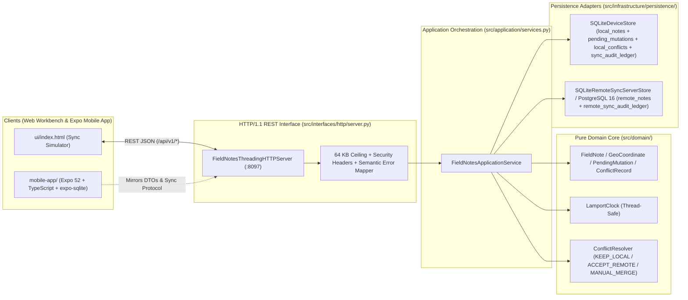

# SPEC-03: Offline-First Sync REST API Contracts, Application Orchestration & React Native Expo Blueprint

- **Bounded Context**: `fieldnotes-mobile` — Application Service, HTTP/1.1 REST API & Mobile Blueprint (`src/application/`, `src/interfaces/http/`, `mobile-app/`)
- **Status**: Approved (SDD-First)
- **Author Role**: `integration-architect`
- **Aligned Specifications**:
  - `.specs/01-domain/offline-first-sync-and-conflict-resolution.spec.md`
  - `.specs/02-data/local-sqlite-outbox-and-sync-audit-ledger.spec.md`
- **Runtime**: Python 3.12+ standard library (`http.server.ThreadingHTTPServer`, `sqlite3`) on port `8097` + Expo 52 / React Native / TypeScript strict blueprint (`mobile-app/`).

---

## 1. Integration Architecture Overview



---

## 2. Security Boundaries & Protocol Headers

Every HTTP response emitted by `FieldNotesHTTPRequestHandler` MUST enforce:

1. **Hard Request Payload Ceiling**: `MAX_JSON_BODY_BYTES = 64 * 1024` (64 KB). Any request whose `Content-Length` or payload body exceeds 65,536 bytes is rejected immediately with `413 Payload Too Large` before JSON decoding.
2. **Mandatory Security Headers**:
   - `X-Content-Type-Options: nosniff`
   - `X-Frame-Options: DENY`
   - `Referrer-Policy: no-referrer`
3. **CORS Policy**:
   - `Access-Control-Allow-Origin: *`
   - `Access-Control-Allow-Methods: GET, POST, OPTIONS`
   - `Access-Control-Allow-Headers: Content-Type, Accept, X-Request-ID`
4. **Zero Stack-Trace Leakage**:
   - Internal Python tracebacks, SQL strings, file system paths, and raw exception internals MUST NEVER be returned to HTTP clients. Unexpected failures map strictly to `500 Internal Server Error` with a static safe message.

---

## 3. Semantic HTTP Status & Exception Mapping

All error responses share a canonical structured envelope:

```json
{
  "error": {
    "code": "ERR-503-DEVICE-OFFLINE",
    "type": "OfflineNetworkError",
    "message": "Device is offline; mutations remain safely queued in local SQLite outbox",
    "details": {
      "device_id": "device-ios-field-01"
    }
  }
}
```

| HTTP Status | Source Exception / Condition | Machine Code (`error.code`) | Semantics |
| :--- | :--- | :--- | :--- |
| `200 OK` | Successful read, update, connectivity change, delta sync, remote edit simulation, or conflict resolution | — | Standard success response |
| `201 Created` | `POST /api/v1/notes/local` creating a brand-new local note (`base_version == 0`) | — | New local field note persisted & queued |
| `204 No Content` | `OPTIONS *` CORS preflight | — | Preflight accepted |
| `400 Bad Request` | `InvalidFieldNoteError`, `MalformedJsonError`, invalid query parameter, non-boolean `is_online` | `ERR-400-INVALID-FIELD-NOTE` / `ERR-400-MALFORMED-JSON` | Schema or domain invariant violation |
| `404 Not Found` | `NoteNotFoundError` (missing `note_id` or `conflict_id`), unknown route | `ERR-404-NOTE-NOT-FOUND` / `ERR-404-ROUTE-NOT-FOUND` | Requested entity or path does not exist |
| `405 Method Not Allowed` | Unsupported HTTP verb on known route (e.g., `PUT`/`DELETE` or `GET` on `POST`-only endpoint) | `ERR-405-METHOD-NOT-ALLOWED` | Includes `Allow` header |
| `409 Conflict` | `SyncConflictError` | `ERR-409-SYNC-CONFLICT` | Direct optimistic concurrency version divergence |
| `413 Payload Too Large` | `PayloadTooLargeError` (body > `64 * 1024` bytes) | `ERR-413-PAYLOAD-TOO-LARGE` | Payload exceeds 64 KB ceiling |
| `422 Unprocessable Entity` | `InvalidConflictResolutionError`, other `DomainError` subclasses | `ERR-422-INVALID-RESOLUTION` | Unsupported strategy, missing merge fields, already resolved conflict, or ID mismatch |
| `503 Service Unavailable` | `OfflineNetworkError` | `ERR-503-DEVICE-OFFLINE` | Sync or conflict resolution attempted while device connectivity is offline |
| `500 Internal Server Error` | Unhandled unexpected runtime exception | `ERR-500-INTERNAL-SERVER-ERROR` | Generic safe message; zero stack trace |

---

## 4. End-to-End REST API Contracts (`/api/v1/*`)

### 4.1 Canonical Domain DTO Schemas

#### `GeoCoordinateDto`
```json
{
  "latitude": 4.711,
  "longitude": -74.0721
}
```

#### `FieldNoteDto`
```json
{
  "note_id": "NOTE-SITE-001",
  "site_code": "SUB-ANDES-01",
  "title": "High-Voltage Transformer Bushing Thermal Hotspot",
  "body": "FLIR thermography recorded 94.2 C...",
  "severity": "CRITICAL",
  "location": { "latitude": 4.711, "longitude": -74.0721 },
  "author_device_id": "device-ios-field-01",
  "version": 1,
  "lamport_ts": 1,
  "sync_state": "SYNCED",
  "updated_at": "2026-11-18T08:00:00+00:00",
  "deleted": false
}
```

#### `PendingMutationDto`
```json
{
  "mutation_id": "mut-a1b2c3d4e5f6",
  "note_id": "NOTE-SITE-001",
  "device_id": "device-ios-field-01",
  "operation": "UPSERT",
  "base_version": 1,
  "lamport_ts": 6,
  "payload_json": "{\"author_device_id\":\"device-ios-field-01\",...}",
  "status": "QUEUED",
  "created_at": "2026-11-19T01:30:00+00:00"
}
```

#### `ConflictRecordDto`
```json
{
  "conflict_id": "conf-1a2b3c4d5e6f",
  "note_id": "NOTE-SITE-001",
  "local_note": { "...FieldNoteDto..." },
  "remote_note": { "...FieldNoteDto..." },
  "detected_at": "2026-11-19T01:31:00+00:00",
  "resolved": false,
  "strategy": null
}
```

#### `SyncAuditRecordDto`
```json
{
  "audit_id": "aud-9f8e7d6c5b4a",
  "device_id": "device-ios-field-01",
  "direction": "BIDIRECTIONAL",
  "pushed_count": 1,
  "pulled_count": 0,
  "conflicts_detected": 1,
  "status": "PARTIAL_CONFLICT",
  "created_at": "2026-11-19T01:31:00+00:00"
}
```

---

### 4.2 Endpoint Specifications

#### 1. `GET /` and `GET /ui`
- **Response (`200 OK`, `text/html; charset=utf-8`)**: Serves `ui/index.html` interactive offline-first sync workbench.

#### 2. `GET /api/v1/health`
- **Response (`200 OK`)**:
```json
{
  "status": "ok",
  "service": "fieldnotes-mobile",
  "device_id": "device-ios-field-01",
  "is_online": true,
  "lamport_ts": 5,
  "last_pull_lamport_ts": 5,
  "local_notes_count": 5,
  "remote_notes_count": 5,
  "queued_mutations_count": 0,
  "unresolved_conflicts_count": 0,
  "sync_audits_count": 0
}
```

#### 3. `POST /api/v1/device/connectivity`
- **Request Body**:
```json
{
  "is_online": false
}
```
- **Validation**: `is_online` MUST be present and a strict JSON boolean (`true` / `false`). Integers (`0`/`1`), strings (`"true"`), or `null` raise `InvalidFieldNoteError` (`400 Bad Request`).
- **Response (`200 OK`)**:
```json
{
  "device_id": "device-ios-field-01",
  "is_online": false,
  "lamport_ts": 5,
  "queued_mutations_count": 0,
  "unresolved_conflicts_count": 0
}
```

#### 4. `GET /api/v1/notes/local`
- **Response (`200 OK`)**:
```json
{
  "notes": [ "...FieldNoteDto[]" ],
  "total": 5,
  "is_online": true,
  "lamport_ts": 5
}
```

#### 5. `POST /api/v1/notes/local`
- **Behavior**: Works identically whether the device is **offline** or **online** (local-first architecture).
  - Determines `base_version = existing.version` when updating an existing local note, or `base_version = 0` when creating a new note (auto-generating `NOTE-<HEX>` if `note_id` is omitted).
  - Advances `LamportClock.tick()` only after domain validation succeeds.
  - Atomically writes `FieldNote` (`sync_state = "PENDING_PUSH"`) into `local_notes` and appends a `PendingMutation` (`status = "QUEUED"`) into `pending_mutations`.
- **Request Body** (create or update):
```json
{
  "note_id": "NOTE-SITE-001",
  "site_code": "SUB-ANDES-01",
  "title": "Updated Transformer Bushing Reading (Offline)",
  "body": "Secondary thermal scan reached 97.5 C; isolation breaker flagged.",
  "severity": "CRITICAL",
  "location": { "latitude": 4.711, "longitude": -74.0721 },
  "author_device_id": "device-ios-field-01"
}
```
- **Response**: `201 Created` when `base_version == 0` (new note), `200 OK` when updating an existing note:
```json
{
  "note": { "...FieldNoteDto (sync_state=PENDING_PUSH)..." },
  "mutation": { "...PendingMutationDto (status=QUEUED)..." },
  "is_online": false
}
```
- **Errors**: `400 Bad Request` (`InvalidFieldNoteError`, `MalformedJsonError`), `413 Payload Too Large`.

#### 6. `GET /api/v1/notes/remote`
- **Response (`200 OK`)**:
```json
{
  "notes": [ "...FieldNoteDto[]" ],
  "total": 5
}
```

#### 7. `POST /api/v1/notes/remote/{note_id}/simulate-edit`
- **Behavior**: Simulates a concurrent modification made by another field technician or dispatch operator directly on the remote sync server while the local device is offline (increments remote `version + 1` and advances remote causal `lamport_ts`).
- **Request Body**:
```json
{
  "title": "Dispatch Update: Transformer Bushing Maintenance Assigned",
  "body": "Crew Bravo dispatched with replacement porcelain bushing.",
  "severity": "CRITICAL",
  "author_device_id": "dispatch-web-02"
}
```
- **Response (`200 OK`)**:
```json
{
  "note": { "...FieldNoteDto (remote updated)..." },
  "remote_note": { "...FieldNoteDto (remote updated)..." },
  "simulated_by": "dispatch-web-02"
}
```
- **Errors**: `400 Bad Request` (`InvalidFieldNoteError`), `404 Not Found` (`NoteNotFoundError`).

#### 8. `GET /api/v1/sync/queue`
- **Query Params**: Optional `?only_queued=true|false` (default `false`).
- **Response (`200 OK`)**:
```json
{
  "mutations": [ "...PendingMutationDto[]" ],
  "queue": [ "...PendingMutationDto[]" ],
  "total": 1,
  "queued_count": 1
}
```

#### 9. `POST /api/v1/sync/run`
- **Request Body**: Optional empty body or `{}`.
- **Offline Gate**: If `is_online is False`, raises `OfflineNetworkError` -> **`503 Service Unavailable`** while preserving every queued mutation intact in SQLite.
- **Online Delta Sync Algorithm**:
  1. **Push Phase**: Iterates `list_pending_mutations(only_queued=True)` in strict causal order `(lamport_ts ASC, created_at ASC, mutation_id ASC)`:
     - Calls `remote_store.push_mutation(mutation_note, base_version=mutation.base_version)`.
     - On `(True, synced_note)`: persists `device_store.save_synced_note(synced_note)`, marks mutation `MutationStatus.SYNCED`, calls `clock.receive(synced_note.lamport_ts)`, increments `pushed_count`.
     - On `(False, remote_note)`: marks mutation `MutationStatus.CONFLICT`, creates & saves `ConflictRecord` via `device_store.record_conflict(...)` (setting local note `sync_state = CONFLICT`), increments `conflicts_detected`.
  2. **Pull Phase**: Queries `remote_store.pull_delta_since(_last_pull_lamport_ts)`:
     - Skips any remote note whose local copy is currently in `PENDING_PUSH` or `CONFLICT`.
     - Skips already-converged echoes of notes pushed in the same cycle while advancing `_last_pull_lamport_ts`.
     - Applies genuinely new/updated remote notes via `device_store.save_synced_note(remote_note)`, calls `clock.receive(remote_note.lamport_ts)`, increments `pulled_count`, and advances `_last_pull_lamport_ts`.
  3. **Audit Phase**: Appends an immutable `SyncAuditRecord` to `sync_audit_ledger` (and `remote_sync_audit_ledger`).
- **Response (`200 OK`)**:
```json
{
  "pushed_count": 0,
  "pulled_count": 0,
  "conflicts_detected": 1,
  "audit": { "...SyncAuditRecordDto..." },
  "conflicts": [ "...ConflictRecordDto[]" ],
  "lamport_ts": 6
}
```
- **Errors**: `503 Service Unavailable` (`OfflineNetworkError`).

#### 10. `GET /api/v1/conflicts`
- **Query Params**: Optional `?unresolved_only=true|false` (default `false`).
- **Response (`200 OK`)**:
```json
{
  "conflicts": [ "...ConflictRecordDto[]" ],
  "total": 1,
  "unresolved_count": 1
}
```

#### 11. `POST /api/v1/conflicts/{conflict_id}/resolve`
- **Offline Gate**: If `is_online is False`, raises `OfflineNetworkError` -> **`503 Service Unavailable`**.
- **Request Body**:
```json
{
  "strategy": "MANUAL_MERGE",
  "merged_title": "Transformer Bushing Hotspot — 97.5 C + Crew Bravo Dispatched",
  "merged_body": "Combined field FLIR 97.5 C scan with Crew Bravo dispatch order."
}
```
- **Resolution Semantics**:
  - Invokes `ConflictResolver.resolve(conflict.local_note, conflict.remote_note, strategy, merged_title, merged_body)`.
  - Promotes converged note (`version = max(local, remote) + 1`, `lamport_ts = max(local, remote) + 1`) to `SyncState.SYNCED`.
  - Persists to `remote_store.force_save_resolved_note(...)` and `device_store.mark_conflict_resolved(...)`.
  - Marks associated `CONFLICT` mutations for `conflict.note_id` as `MutationStatus.SYNCED`.
  - Advances `LamportClock.receive(resolved.lamport_ts)` and appends an immutable `SyncAuditRecord`.
- **Response (`200 OK`)**:
```json
{
  "conflict": { "...ConflictRecordDto (resolved=true, strategy=MANUAL_MERGE)..." },
  "resolved_note": { "...FieldNoteDto (sync_state=SYNCED)..." },
  "audit": { "...SyncAuditRecordDto..." }
}
```
- **Errors**: `400 Bad Request`, `404 Not Found` (`NoteNotFoundError`), `422 Unprocessable Entity` (`InvalidConflictResolutionError`), `503 Service Unavailable` (`OfflineNetworkError`).

#### 12. `GET /api/v1/sync/audit`
- **Query Params**: Optional `?limit=50` (positive integer `1..500`).
- **Response (`200 OK`)**:
```json
{
  "audits": [ "...SyncAuditRecordDto[]" ],
  "ledger": [ "...SyncAuditRecordDto[]" ],
  "total": 2
}
```

---

## 5. React Native (Expo 52 + TypeScript) Mobile App Blueprint (`mobile-app/`)

The `mobile-app/` directory mirrors the Python reference engine in strict TypeScript (`"strict": true`, zero `any`) following Clean Architecture:

| Layer | Path | Responsibility |
| :--- | :--- | :--- |
| Domain Entities & DTOs | `mobile-app/src/domain/FieldNote.ts` | Readonly TypeScript models (`FieldNote`, `GeoCoordinate`, `PendingMutation`, `ConflictRecord`, `SyncAuditRecord`) + invariant validators & typed errors |
| Domain Sync Engine | `mobile-app/src/domain/ConflictResolver.ts` | `LamportClock` + deterministic `ConflictResolver` (`KEEP_LOCAL`, `ACCEPT_REMOTE`, `MANUAL_MERGE`) |
| Data / Persistence | `mobile-app/src/data/SqliteOutboxRepository.ts` | `expo-sqlite` local-first adapter with transactional outbox queueing, append-only audit triggers, and typed REST sync client |
| Presentation UI | `mobile-app/src/presentation/FieldNotesScreen.tsx` | Mobile screen with offline connectivity banner, queued mutation badge, monotonic Lamport telemetry, and conflict resolution modal sheet |

---

## 6. Verification Acceptance Criteria

1. Offline capture via `POST /api/v1/notes/local` while `is_online=false` returns `201` (new) / `200` (update) with `sync_state="PENDING_PUSH"` and `mutation.status="QUEUED"`.
2. Sync attempt via `POST /api/v1/sync/run` while offline returns `503 Service Unavailable` (`ERR-503-DEVICE-OFFLINE`) and preserves queued mutations.
3. Concurrent server edit via `POST /api/v1/notes/remote/{note_id}/simulate-edit` advances remote `version + 1` without touching local storage.
4. Reconnecting (`POST /api/v1/device/connectivity` `{"is_online": true}`) and invoking `POST /api/v1/sync/run` detects the version divergence, sets local note to `CONFLICT`, queues an unresolved `ConflictRecord`, and appends a `PARTIAL_CONFLICT` audit record.
5. Resolving via `POST /api/v1/conflicts/{conflict_id}/resolve` with `MANUAL_MERGE` converges both local and remote stores to `version = max(local, remote) + 1`, `sync_state = "SYNCED"`, `unresolved_conflicts_count = 0`, and `queued_mutations_count = 0`.
6. Security checks verify `413` on payloads `> 64 KB`, `400` on non-bool connectivity or invalid coordinates, `422` on incomplete `MANUAL_MERGE`, `404` on unknown IDs, `405` on unsupported verbs, security headers on every response, and zero stack traces in error payloads.
