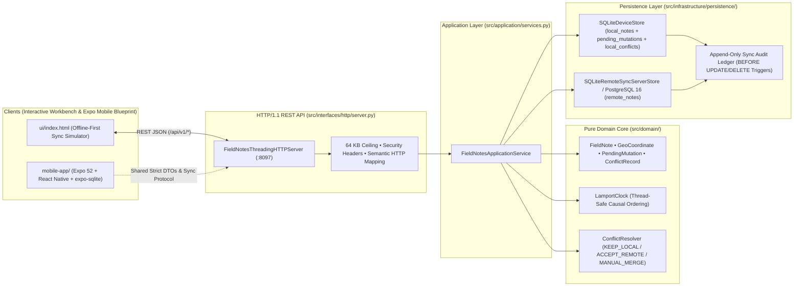

# FieldNotes Mobile — Offline-First Sync Engine, SQLite Outbox & Conflict Resolution

[](https://www.python.org/)
[](./mobile-app/package.json)
[](./.specs/01-domain/offline-first-sync-and-conflict-resolution.spec.md)
[](./docs/adr/001-local-first-sqlite-outbox-sync.md)

**FieldNotes Mobile** is a production-grade **Local-First, Offline-First Mobile Field Inspection & Delta Synchronization Platform** engineered under **Spec-Driven Development (SDD)**, **Clean Architecture**, and **Domain-Driven Design (DDD)**. It pairs a zero-dependency **Python 3.12 Offline-First Sync Engine & Interactive Workbench** with a strict TypeScript **React Native (Expo 52 + `expo-sqlite`) Mobile App Blueprint**, guaranteeing zero silent data loss across disconnected industrial environments.

---

## 1. Architecture Overview



### Key Engineering Capabilities
- **Local-First ACID SQLite Outbox (`src/infrastructure/persistence/sqlite_sync_stores.py`, `mobile-app/src/data/SqliteOutboxRepository.ts`)**:
  - Every offline or online edit commits `local_notes` (`PENDING_PUSH`) and `pending_mutations` (`QUEUED`) inside a single ACID SQLite transaction so mutations survive crashes, dead zones, and offline retries.
- **Thread-Safe Lamport Logical Clocks (`src/domain/sync_engine.py`, `mobile-app/src/domain/ConflictResolver.ts`)**:
  - Immune to mobile wall-clock skew: local writes advance `tick()`, remote sync merges advance `max(local, remote) + 1`, and incremental pulls query strictly by causal Lamport watermark (`pull_delta_since`).
- **Optimistic Concurrency & Explicit Conflict Resolution (`ConflictResolver`)**:
  - Rejects stale pushes (`base_version != server_version`) without overwriting remote data, records side-by-side `ConflictRecord` snapshots, and converges via `KEEP_LOCAL`, `ACCEPT_REMOTE`, or `MANUAL_MERGE` with `next_version = max(local, remote) + 1` and `next_lamport = max(local, remote) + 1`.
- **Database-Enforced Append-Only Sync Audit Ledger (`migrations/001_init_fieldnotes_sync.sql`)**:
  - Both SQLite and PostgreSQL 16 enforce `BEFORE UPDATE` and `BEFORE DELETE` triggers raising `APPEND_ONLY_LEDGER_VIOLATION` on sync audit history.
- **Hardened HTTP/1.1 Interface (`src/interfaces/http/server.py`)**:
  - Enforces a `64 KB` payload ceiling (`413`), strict security headers (`X-Content-Type-Options: nosniff`, `X-Frame-Options: DENY`, `Referrer-Policy: no-referrer`), semantic HTTP codes (`200`, `201`, `400`, `404`, `405`, `409`, `413`, `422`, `503`, `500`), and zero stack-trace leakage.

---

## 2. REST API Endpoints (`/api/v1/*`)

| Method | Path | Description | Success | Error Codes |
| :--- | :--- | :--- | :--- | :--- |
| `GET` | `/` or `/ui` | Interactive Offline-First Sync Workbench (`ui/index.html`) | `200 OK` | — |
| `GET` | `/api/v1/health` | Device status, connectivity, Lamport clock & queue telemetry | `200 OK` | `500` |
| `POST` | `/api/v1/device/connectivity` | Toggle strict boolean `is_online` connectivity state | `200 OK` | `400`, `413` |
| `GET` | `/api/v1/notes/local` | List on-device field inspection notes | `200 OK` | `500` |
| `POST` | `/api/v1/notes/local` | Local-first create/update (works offline or online) + outbox enqueue | `201 Created` / `200 OK` | `400`, `413` |
| `GET` | `/api/v1/notes/remote` | List authoritative remote server inspection notes | `200 OK` | `500` |
| `POST` | `/api/v1/notes/remote/{note_id}/simulate-edit` | Simulate concurrent edit by another technician on the server | `200 OK` | `400`, `404`, `413` |
| `GET` | `/api/v1/sync/queue` | Inspect local transactional outbox queue (`?only_queued=true\|false`) | `200 OK` | `400` |
| `POST` | `/api/v1/sync/run` | Execute bidirectional delta sync (push outbox + pull delta + audit) | `200 OK` | `503` (Offline) |
| `GET` | `/api/v1/conflicts` | List detected optimistic concurrency conflicts (`?unresolved_only=true\|false`) | `200 OK` | `400` |
| `POST` | `/api/v1/conflicts/{conflict_id}/resolve` | Resolve conflict (`KEEP_LOCAL` / `ACCEPT_REMOTE` / `MANUAL_MERGE`) | `200 OK` | `400`, `404`, `422`, `503` |
| `GET` | `/api/v1/sync/audit` | Query append-only sync audit ledger (`?limit=50`) | `200 OK` | `400` |

---

## 3. Quickstart (1-Command Startup)

### Option A: Native Python 3.12 (Zero External Dependencies)

```bash
python -m src.main
```

Open **http://127.0.0.1:8097** in your browser to launch the interactive Offline-First Sync Workbench (or query `http://127.0.0.1:8097/api/v1/health`).

### Option B: Docker Multi-Stage Container + PostgreSQL 16

```bash
docker compose up --build
```

### Option C: React Native (Expo 52 + TypeScript) Mobile App Blueprint

```bash
cd mobile-app
npm install
npm run typecheck
npx expo start
```

### Run Test Suite

```bash
python -m unittest discover -s tests -v
```

---

## 4. Repository Structure, Specifications & ADRs

- `.specs/01-domain/offline-first-sync-and-conflict-resolution.spec.md` — Domain invariants, `LamportClock`, and `ConflictResolver` specification.
- `.specs/02-data/local-sqlite-outbox-and-sync-audit-ledger.spec.md` — SQLite local-first outbox, remote store, PostgreSQL 16 migration, and append-only triggers.
- `.specs/03-integration/offline-sync-api-and-expo-app.spec.md` — End-to-end REST DTO contracts, HTTP status mapping, and Expo TypeScript architecture.
- `docs/adr/001-local-first-sqlite-outbox-sync.md` — ADR for Local-First SQLite Outbox & Append-Only Audit Ledger.
- `docs/adr/002-lamport-clocks-and-explicit-conflict-resolution.md` — ADR for Lamport Logical Clocks & Explicit Deterministic Conflict Resolution.
- `mobile-app/` — Strict TypeScript React Native (Expo 52 + `expo-sqlite`) Clean Architecture blueprint (`domain/`, `data/`, `presentation/`).
