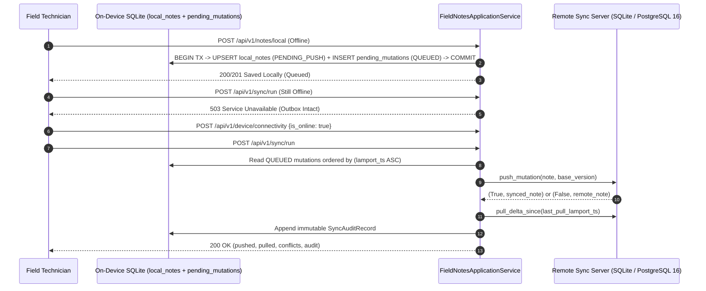

# ADR-001: Local-First SQLite Storage, Transactional Outbox Pattern & Append-Only Sync Audit Ledger

- **Status**: Accepted
- **Date**: 2026-11-19
- **Deciders**: `domain-architect`, `data-architect`, `integration-architect`
- **Bounded Context**: `fieldnotes-mobile` (Python 3.12 Sync Engine & Expo `expo-sqlite` Mobile Blueprint)

---

## 1. Context

Industrial field technicians inspect substations, pipelines, wind turbines, compressors, and solar arrays across remote areas with prolonged dead zones, intermittent LTE, or complete RF shielding. Traditional request-response mobile architectures fail in these environments:

1. **Blocked Writes & Data Loss**: Blocking form submission on an HTTP round-trip loses critical safety observations when connectivity drops mid-inspection.
2. **Dual-Write Anomalies**: Writing to local storage and independently issuing a network call or writing to an in-memory retry queue causes lost mutations on app crashes, OS memory eviction, or battery depletion.
3. **Opaque Sync Failures**: Without an immutable record of what was pushed, pulled, or conflicted, compliance audits and field operations teams cannot prove when a critical inspection reading was captured versus synchronized.

---

## 2. Decision

We adopt a **Local-First SQLite Architecture** combined with the **Transactional Outbox Pattern** and a **Database-Enforced Append-Only Sync Audit Ledger**:

1. **Immediate Local Persistence (`local_notes` + `pending_mutations`)**:
   - Every create/update/delete executes locally inside a **single ACID SQLite transaction** (`SQLiteDeviceStore.upsert_local_note_offline` in Python and `SqliteOutboxRepository.upsertLocalNoteOffline` in `expo-sqlite`).
   - Both `local_notes` (marked `sync_state = 'PENDING_PUSH'`) and `pending_mutations` (marked `status = 'QUEUED'`, carrying `base_version`, `lamport_ts`, and canonical `payload_json`) commit atomically or roll back together.
2. **Causal Outbox Draining & Bidirectional Delta Sync**:
   - When offline, sync attempts fail fast with `OfflineNetworkError` (`HTTP 503`) without mutating or discarding queued rows.
   - Upon reconnection, queued mutations drain in deterministic causal order `(lamport_ts ASC, created_at ASC, mutation_id ASC)` followed by an incremental delta pull (`WHERE lamport_ts > last_pull_lamport_ts`) that never overwrites local notes in `PENDING_PUSH` or `CONFLICT`.
3. **Database-Enforced Append-Only Audit Ledger (`sync_audit_ledger`)**:
   - Every sync cycle and conflict resolution appends an immutable `SyncAuditRecord` to `sync_audit_ledger`.
   - Both SQLite (`BEFORE UPDATE` / `BEFORE DELETE` `RAISE(ABORT, 'APPEND_ONLY_LEDGER_VIOLATION: ...')`) and PostgreSQL (`prevent_sync_audit_mutation()` in `migrations/001_init_fieldnotes_sync.sql`) enforce append-only immutability at the database engine layer.

---

## 3. Consequences

### Positive
- **Zero Data Loss Across Restarts & Dead Zones**: Atomic SQLite transactions guarantee every captured inspection note has a durable outbox entry surviving process kills and offline intervals.
- **Deterministic Replay**: Causal sorting ensures multi-edit offline sequences replay in exact order against the remote sync server.
- **Tamper-Evident Auditability**: Database triggers prevent accidental or malicious mutation/deletion of synchronization history in both mobile SQLite and cloud PostgreSQL.

### Trade-offs & Mitigations
- **Local Storage Growth**: Resolved mutations remain in `pending_mutations` for operational traceability; production deployments can archive `SYNCED` outbox rows older than a retention window while keeping `sync_audit_ledger` immutable.
- **Deferred Conflict Discovery**: Because writes succeed offline without contacting the server, concurrent edits are discovered at sync time rather than write time — directly addressed by [ADR-002](./002-lamport-clocks-and-explicit-conflict-resolution.md).

---

## 4. References

- `.specs/02-data/local-sqlite-outbox-and-sync-audit-ledger.spec.md`
- `.specs/03-integration/offline-sync-api-and-expo-app.spec.md`
- `src/infrastructure/persistence/sqlite_sync_stores.py`
- `migrations/001_init_fieldnotes_sync.sql`
- `mobile-app/src/data/SqliteOutboxRepository.ts`
