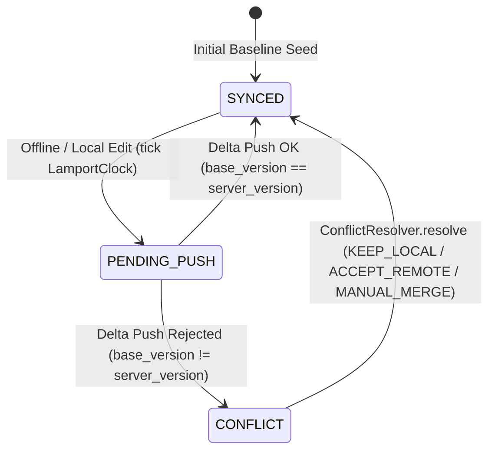

# ADR-002: Lamport Logical Clocks & Explicit Deterministic Conflict Resolution

- **Status**: Accepted
- **Date**: 2026-11-19
- **Deciders**: `domain-architect`, `integration-architect`
- **Bounded Context**: `fieldnotes-mobile` (`src/domain/sync_engine.py`, `mobile-app/src/domain/ConflictResolver.ts`)

---

## 1. Context

When multiple field technicians or dispatch operators edit the same inspection report concurrently while disconnected, two classic distributed-systems pitfalls emerge:

1. **Unreliable Device Wall Clocks**: Mobile devices in offline industrial sites frequently drift from NTP, change time zones, or step backward upon network re-sync. Relying on `updated_at` timestamps for causal ordering or delta cursors silently drops updates or misorders events.
2. **Silent Data Destruction via Last-Write-Wins (LWW)**: Naive LWW overwrites a technician's safety-critical thermal reading with a dispatch comment (or vice versa) without notifying anyone, violating industrial safety and traceability requirements.

---

## 2. Decision

We replace wall-clock ordering and silent LWW with **Thread-Safe Lamport Logical Clocks**, **Optimistic Concurrency Control (OCC)**, and **Explicit Deterministic Conflict Resolution**:

1. **Thread-Safe Lamport Logical Clock (`LamportClock`)**:
   - Local mutation event: $L_{\text{local}} \leftarrow L_{\text{local}} + 1$ (`tick()`).
   - Remote sync merge event: $L_{\text{local}} \leftarrow \max(L_{\text{local}}, L_{\text{remote}}) + 1$ (`receive(remote_ts)`).
   - Restored cleanly from durable storage on boot via `LamportClock(initial=device_store.get_max_lamport_ts())`.
   - Delta pulls use strictly monotonic Lamport watermarks (`WHERE lamport_ts > since_lamport_ts`) rather than device wall clocks.
2. **Optimistic Concurrency Control (`base_version` vs `server_version`)**:
   - Every queued mutation records the exact `base_version` observed on the device prior to editing.
   - During push, the server verifies `remote.version == base_version`:
     - **Match**: Clean fast-forward to `version = base_version + 1` and `lamport_ts = max(remote.lamport_ts, note.lamport_ts) + 1`.
     - **Divergence**: Server rejects the push without overwriting remote state; the local store persists a `ConflictRecord` preserving **both** `local_note` and `remote_note` snapshots and transitions the local note to `SyncState.CONFLICT`.
3. **Explicit Deterministic Resolution (`ConflictResolver.resolve`)**:
   - Operators explicitly select one of three deterministic strategies:
     - `KEEP_LOCAL`: Preserves the field technician's local inspection data.
     - `ACCEPT_REMOTE`: Adopts the authoritative remote server state.
     - `MANUAL_MERGE`: Requires validated non-empty `merged_title` and `merged_body` (`InvalidConflictResolutionError` $\rightarrow$ `HTTP 422` if blank) combining both observations.
   - Regardless of strategy, the resolved note strictly dominates both conflicting lineages:
     $$\text{next\_version} = \max(\text{local.version},\; \text{remote.version}) + 1$$
     $$\text{next\_lamport} = \max(\text{local.lamport\_ts},\; \text{remote.lamport\_ts}) + 1$$
   - Both Python (`src/domain/sync_engine.py`) and TypeScript (`mobile-app/src/domain/ConflictResolver.ts`) implement the exact same formulas and invariants.

---

## 3. Consequences

### Positive
- **Zero Silent Overwrites**: Concurrent edits on safety-critical field notes are always surfaced side-by-side and resolved with explicit operator accountability.
- **Wall-Clock Immunity**: Causal ordering and incremental delta synchronization remain mathematically monotonic even if a device clock drifts by hours.
- **Cross-Platform Parity**: The backend sync engine and React Native Expo client share identical conflict semantics and error codes (`409`, `422`, `503`).

### Trade-offs & Mitigations
- **Human-in-the-Loop Intervention**: Conflicts remain flagged (`CONFLICT`) until an operator chooses a strategy. The UI/mobile app highlights active conflicts prominently and pre-populates merge drafts to keep resolution fast in the field.

---

## 4. References

- `.specs/01-domain/offline-first-sync-and-conflict-resolution.spec.md`
- `.specs/03-integration/offline-sync-api-and-expo-app.spec.md`
- `src/domain/sync_engine.py`
- `mobile-app/src/domain/ConflictResolver.ts`
